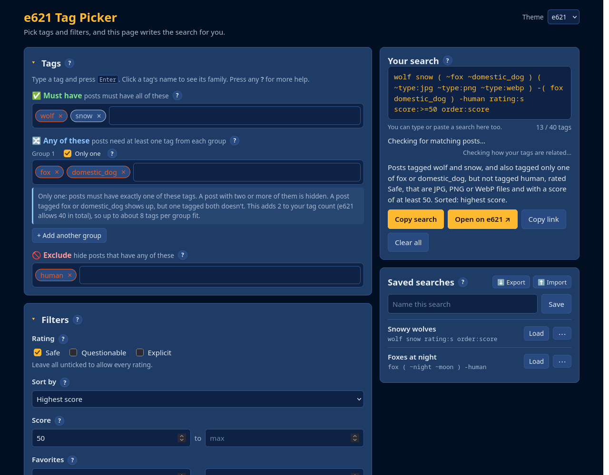
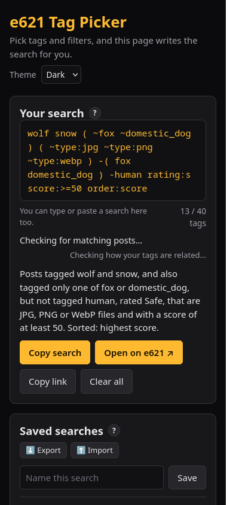

# e621 Tag Picker

A simple web page that helps you build [e621](https://e621.net) searches without memorizing the search syntax.
Pick tags and filters with buttons, and the page writes the search for you, then explains it in plain English.

> **Unofficial fan-made tool.** Not affiliated with or endorsed by e621.
> It only builds searches; all posts and tags come from e621.net.
> e621 is an adult website, so this tool is meant for people 18 and older.
>
> **Made with AI.** Most of the code and text was written by an AI assistant. See [AI disclosure](#ai-disclosure).

**Try it:** https://fizz12215.github.io/e621-tag-picker/



## What it does

Normally, e621 searches look like this:

```
wolf snow ( ~fox ~domestic_dog ) -human rating:s score:>=50 order:score
```

With the Tag Picker you never have to type that. You put tags into boxes and click filters, and it shows you:

- the finished search, ready to copy or open on e621
- a plain-English sentence: *"Posts tagged wolf and snow, and also tagged fox or domestic_dog, but not tagged human, rated Safe, with a score of at least 50. Sorted: highest score."*
- warnings when something can't work, like a tag that's both required and excluded

## Features

**Tags**
- **Must have**, **Any of these** (as many groups as you like), and **Exclude** boxes
- Tag suggestions from e621 as you type, colored by tag type (species, artist, character…)
- **Only one** option: posts must have exactly one tag from a group
- Click a tag to see its family: what it automatically includes (wolf → canine → canid → mammal) and its sub-types, with one-click exclude
- Tips when a shorter search would do the same job (wolf + fox → canine)
- Tags typed by hand are checked: old names are swapped for e621's name (dog → domestic_dog), and misspellings are pointed out

**Filters**
- Rating, sort order, score and favorite ranges, upload date
- File types with want / exclude buttons, and one-click Pictures or Animations
- Advanced: image size, video length, uploader, favorites, pools, sets, description, post status, and a box for anything else

**Your search**
- Type or paste any e621 search into the search box, and the boxes fill in to match
- Checks whether any posts match, and can count them
- Copy the search, copy the link (handy for private windows), or open it on e621

**Saved searches**
- Save, rename, load and delete searches
- Export them to a file as a backup, and import them on another device

**Other**
- e621 (blue) and Dark themes
- A **?** button on every section with detailed help
- Works on phones



## How to use it

- **Online:** open https://fizz12215.github.io/e621-tag-picker/
- **On your own computer:** download this project (green **Code** button → **Download ZIP**), unzip it, and open `index.html` in your browser. Nothing to install.
- **Firefox add-on (computer and Android):** adds a **Tag Picker** button under e621's own search bar. See [Firefox add-on](#firefox-add-on).

## Firefox add-on

The add-on puts a **Tag Picker** button right under the search bar on e621.net (and e926.net).
Tap it, and the Tag Picker opens in a panel on top of e621, already filled in with whatever was in e621's search bar.
Pick your tags and filters, press **Use this search**, and e621 runs it. It works in Firefox on computers and on Android.

The add-on is the same Tag Picker as the website. Its saved searches are kept separately from the website's,
so use **Export** and **Import** to move them between the two.

**Building it:** run `./build-extension.sh`. It copies the website files into the add-on and makes:
- `dist/firefox/`: the add-on as a folder
- `dist/e621-tag-picker-firefox-<version>.zip`: the add-on as one file, ready to upload to Mozilla

**Trying it on a computer:** in Firefox, open `about:debugging#/runtime/this-firefox`, click **Load Temporary Add-on…**,
and pick `dist/firefox/manifest.json`. It stays until Firefox closes.

**Installing it for good (needed on Android):** Firefox only installs add-ons that Mozilla has signed.
Upload the zip at [addons.mozilla.org/developers](https://addons.mozilla.org/developers/) to get it signed.

## Privacy

Everything runs in your own browser. The page only talks to e621 itself (for tag suggestions, tag families and match counts), with no account or login.
Saved searches and settings are stored in your browser only, and never sent anywhere.

## How it's built

Plain HTML, CSS and JavaScript, with no frameworks and no build step for the website:

| File | What's in it |
|---|---|
| `index.html` | Everything you see on the page |
| `style.css` | Colors, layout and the two themes |
| `app.js` | The logic: tag boxes, building the search, reading pasted searches, talking to e621 |
| `theme.js` | Picks the saved theme before the page shows, so the colors don't flash |
| `extension/` | The Firefox add-on: `manifest.json` describes it, `content.js` and `content.css` add the button and panel to e621 |
| `build-extension.sh` | Builds the add-on from the files above |

Search rules come from e621's [search cheatsheet](https://e621.net/help/cheatsheet). Requests to e621 are spaced out to stay within the
[API's rate limits](https://e621.net/help/api).

## AI disclosure

This project was made with **Claude**, an AI assistant by Anthropic, using Claude Code.

- **Written by AI:** most of the code (`index.html`, `style.css`, `app.js`, `theme.js` and the Firefox add-on), the help text inside the app, and this README.
- **Done by a person ([Fizz12215](https://github.com/Fizz12215)):** the idea, choosing every feature and how it should look and work, and trying it out and reporting problems.
- **Testing:** the AI checked features in a browser and ran the searches the page builds against e621 to make sure they find the right posts. That catches a lot, but not everything, so if something seems wrong, please open an issue.

Made by [Fizz12215](https://github.com/Fizz12215).
